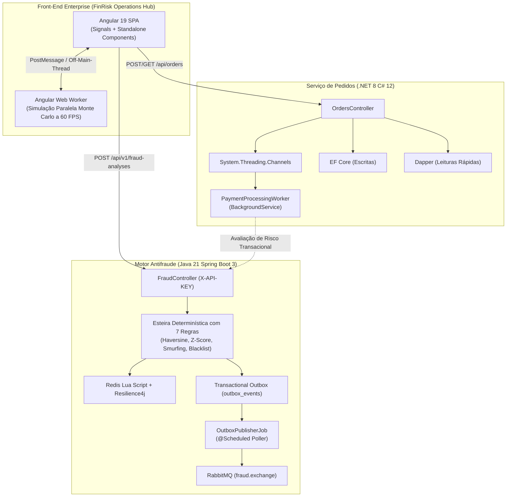

# 🛡️ FinRisk Operations Hub — Portal Corporativo de Pedidos & Antifraude

[](https://angular.dev/)
[](https://www.typescriptlang.org/)
[](https://tailwindcss.com/)
[](https://developer.mozilla.org/en-US/docs/Web/API/Web_Workers_API)
[](https://vercel.com/)
[](LICENSE)

Portal Web Corporativo desenvolvido em **Angular 19** que atua como o **Cockpit de Operações e Gestão de Risco** unificando dois microsserviços de alto nível:
1. **[order-processing-api](https://github.com/FelipeGardenghiDev/order-processing-api)**: Microsserviço corporativo em **.NET 8 (C# 12)** com Clean Architecture, CQRS (EF Core + Dapper) e canais assíncronos.
2. **[fraud-detection-api](https://github.com/FelipeGardenghiDev/fraud-detection-api)**: Motor de risco e prevenção a fraudes em tempo real em **Java 21 e Spring Boot 3** com Transactional Outbox Pattern e RabbitMQ.

---

## 🏛️ Arquitetura Integrada do Ecossistema



---

## ⚙️ Os 3 Níveis de Background Workers no Ecossistema

O projeto foi desenhado para demonstrar maturidade de engenharia de software distribuída através de **processamento assíncrono em três camadas**:

| Camada | Tecnologia | Implementação | Responsabilidade |
| :--- | :--- | :--- | :--- |
| **Back-end .NET** | .NET 8 / C# 12 | `PaymentProcessingWorker` (`BackgroundService`) | Consome a fila assíncrona desacoplada (`System.Threading.Channels`), executando a autorização de pagamento e a transição de máquina de estados (`Pending` ➔ `Processing` ➔ `Paid`). |
| **Back-end Java** | Java 21 / Spring Boot 3 | `OutboxPublisherJob` (`@Scheduled`) | Garante o *Transactional Outbox Pattern*, buscando eventos pendentes de fraude na mesma transação atômica do banco e despachando para a exchange do RabbitMQ com garantia *at-least-once*. |
| **Front-end Angular** | Angular 19 / Web Worker API | `risk-calculator.worker.ts` | Executa cálculos matemáticos de projeção de estresse e Monte Carlo (avaliando até 15.000 transações sintéticas) em uma **thread secundária isolada**, sem congelar a UI principal. |

---

## 📱 Design Responsivo & Mobile-First

O FinRisk Hub foi planejado tanto para operação em monitores corporativos widescreen quanto para dispositivos móveis:
* **No Desktop:** Layout denso no estilo *Stripe / Bloomberg Dashboard*, com sidebar de atalhos, tabelas expansíveis, monitor de logs de background e termômetro visual de Score de Risco.
* **No Mobile (Smartphones):** Barra de navegação inferior (*Bottom Navigation Bar*), tabelas transformadas em cards touch-friendly com badges de status coloridos, inputs confortáveis e navegação fluida para visualização em trânsito.

---

## 🚀 Funcionalidades Principais

1. **Cockpit Unificado (Dashboard):**
   * Indicadores de Faturamento Aprovado (.NET CQRS) vs. Capital Protegido pelo Motor Antifraude (Java 21).
   * Monitor de pulso das filas distribuídas em tempo real.
   * Feeds rápidos de pedidos e análises recentes via **Angular Signals**.

2. **Gestão de Pedidos B2B (Módulo .NET):**
   * Cadastro dinâmico com **Reactive Forms** tipados (`FormArray` para múltiplos itens, cálculo automático de subtotal).
   * Listagem com badges de ciclo de vida (`Pending`, `Processing`, `Paid`, `Failed`).
   * Ação direta de auditoria: qualquer pedido pode ser despachado para avaliação no motor Java com 1 clique.

3. **Central de Risco & Antifraude (Módulo Java):**
   * Simulador interativo com cenários pré-configurados (*Transação Segura*, *Suspeita Noturna*, *Fraude Crítica / Blacklist*).
   * Termômetro visual de `RiskScore` (0 a 100):
     * 🟢 **0–39:** `APPROVED`
     * 🟡 **40–79:** `SUSPICIOUS` (com botões de aprovação/rejeição manual por analista de compliance)
     * 🔴 **80–100:** `BLOCKED`
   * Detalhamento das regras violadas (Blacklist de CPF/IP, High Amount > R$ 5.000, Janela Noturna 22h-06h, Velocity Burst).

4. **Central de Workers & Observabilidade:**
   * Cartões de status e métricas dos 3 workers (.NET Channels, Java Outbox, Angular Worker).
   * Arena de Teste de Estresse do Web Worker (lotes de 1.000, 5.000 e 15.000 cenários).
   * Console de logs ao vivo com níveis `INFO`, `WARN`, `SUCCESS` e `ERROR`.

5. **Modo Híbrido (Live Localhost vs. Demo Cloud):**
   * Possui chave seletora na barra superior:
     * **Modo Demo Cloud (Ativo por padrão para Vercel):** Executa um pipeline resiliente em memória que emula as respostas e transições de estado das APIs reais, permitindo que qualquer pessoa teste o projeto na nuvem sem precisar de backends locais.
     * **Modo Localhost APIs:** Faz requisições HTTP reais para `http://localhost:5000` (.NET) e `http://localhost:8080` (Java) com cabeçalho `X-API-KEY`.

---

## 💻 Como Executar Localmente

### Pré-requisitos
* **Node.js** (versão 18 ou superior instalada).
* **NPM** ou **PNPM**.

### 1️⃣ Clonar o Repositório
```bash
git clone https://github.com/FelipeGardenghiDev/finrisk-operations-hub.git
cd finrisk-operations-hub
```

### 2️⃣ Instalar Dependências
```bash
npm install --legacy-peer-deps
```

### 3️⃣ Iniciar Servidor de Desenvolvimento
```bash
npm start
```
Acesse no navegador: 👉 **http://localhost:4200**

---

## ☁️ Deploy Gratuito na Vercel

O projeto foi configurado com suporte nativo a Single Page Application (SPA):
* O arquivo [`vercel.json`](vercel.json) contém o redirecionamento automático de rotas para `index.html`.
* O build gera a saída otimizada em `dist/finrisk-operations-hub/browser`.
* Para subir na Vercel: basta importar o repositório no dashboard da Vercel com o preset **Angular**.

---

## 📄 Licença

Distribuído sob a licença **MIT**. Consulte o arquivo `LICENSE` para mais informações.
